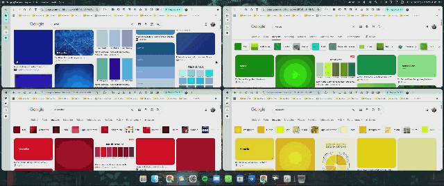

# Adaptive Windows

*(Português do Brasil logo abaixo / Brazilian Portuguese below)*

## English

An automatic tiling window manager for Windows 11, inspired by the **Nava OS** concept videos.
It arranges the windows of each monitor in a grid, animates every change with fluid transitions,
and works together with minimize / restore / open animation mods: a window is animated
**straight to the new place assigned by the grid**, not to where it used to be.

The mod runs in its own `windhawk.exe` process (a Windhawk "tool mod"), not inside Explorer, so a
problem in it cannot take down the taskbar or File Explorer.

### Features
- **Automatic grid.** A new window takes a slot and the others make room for it; when a window
  closes or is minimized, the rest take over the free space.
- **Respects each app's minimum size.** The grid reshapes itself so no window ends up smaller than
  its app allows or overlaps another one (for example Outlook and Spotify together on a short
  screen). If a chosen layout does not fit, the automatic layout is used.
- **Free resizing.** Drag a window edge and the grid adapts to the width or height you chose.
  Dragging a window by its title and dropping it over another one swaps the two; dropping it
  anywhere else sends it back to its slot.
- **Move windows with the keyboard.** Win + Alt + arrows swap the focused window with its neighbor
  on that side.
- **Maximized windows** that return to or enter the grid go back to normal mode and take their slot.
- **Animated border on the focused window**: color, effect (solid, pulse, rainbow, gradient), line
  width, glow, corner radius and offset, so it can match your rounded corners mod.
- **Multiple monitors.** Each monitor has its own grid, and windows can be dragged between them,
  including monitors with different display scales. It works within the limits each window or app
  imposes: the minimum size is decided by the app (and grows with the monitor's scale), so an app
  whose minimum is wider than the monitor will overflow its right / bottom edge.

### Free resizing: when it works
Dragging a window border adapts the grid only when all of these are true:
- The window is in the grid: not taken out with the float hotkey, not maximized and not minimized.
- There are at least two windows in the grid on the same monitor.
- You drag an edge that faces another window. An edge against the screen border has no neighbor to
  take space from, so dragging it does nothing and the window goes back to its slot.
- You hold the window by its border (within about 12 px of the left, right or bottom edge, or the
  top 5 px) and change its size by more than 6 px. Holding it by the middle or the title bar moves
  the window instead (drop it over another window to swap, anywhere else to send it back).

In the "main left" / "main top" layouts, dragging the divider of the main window changes how much of
the screen it takes. Each app's minimum size still applies. Your sizes are discarded when a window
is opened, closed or minimized, when the layout changes and when you re-arrange everything
(Win + Alt + Home).

### Hotkeys
| Hotkey | Action |
|--------|--------|
| Win + Ctrl + G | Cycle the layout: auto, columns, rows, grid, main left, main top |
| Win + Ctrl + T | Take the focused window out of the grid (it stays where it is and the others use the space); press again to put it back |
| Win + Alt + F | Focus mode: every window on the monitor fills the screen; press again to leave |
| Win + Alt + ← / → | Move the focused window left / right: swaps it with the window next to it on that side, whatever the layout (does nothing if there is none) |
| Win + Alt + ↑ / ↓ | Move the focused window up / down: swaps it with the window directly above / below it (does nothing if there is none) |
| Win + Alt + Home | Re-arrange everything and put all windows back in the grid |

Every hotkey can be changed in the settings, and the change applies as soon as you save them:
- **Layout, float and re-arrange** have their own text fields (for example `Ctrl+Alt+G`, `Win+T` or
  `Alt+Home`). Write modifiers (Ctrl, Alt, Shift, Win) and one key: a letter, a digit, or Up, Down,
  Left, Right, Home or End. Leave a field empty to turn that hotkey off.
- **Focus mode and the four arrows** share one modifier choice: Win+Alt (default), Ctrl+Alt,
  Ctrl+Alt+Shift or Alt+Shift.
- Avoid combinations without Win or Ctrl: they take the key away from every other app.

Hotkeys that cannot be registered are reported in the Windhawk log (error 1409 = already in use).
Win + Alt + ↑ is one of them unless you turn on *Take over hotkeys* (see below).
Win + Ctrl + T is also the default Always On Top shortcut of PowerToys: if you use both, change one
of them.

#### Taking over shortcuts that are already in use
Windows itself uses some of these combinations: Win + Alt + ↑ snaps the window to the top half of the
screen, so with the default settings it is unavailable to the mod (the log reports error 1409) and
Windows keeps handling it. The mod never overrides another program's shortcut unless you ask it to.
To use Win + Alt + ↑, turn on the *Take over hotkeys* option (off by default) or pick another set
of modifiers for the arrows. With the option on, whenever a hotkey is already taken the mod
catches that combination with a low-level keyboard hook, so the other program or Windows no longer
receives it. The hook runs in a thread of its own, exists only while the mod runs, and only for the
combinations that were already taken.

### Works with other animation mods
Adaptive Windows works together with these two mods:

- **MacOS Minimize Animation** (genie effect for minimize, restore and open).

- **Windows Animations**.

Those mods hide the window and play their own animation. With the *sync with open/close
animations* option on, Adaptive Windows notices this, puts the window in its final slot while it
is hidden, and only animates the other windows making room, at the same time. Each window has a
single animation, so nothing fights.

For the genie to land in the right place, while a window is minimized the mod writes into Windows
the slot it will occupy when it comes back, and keeps that value up to date as the grid changes.
This way the restore animation ends where the window will really be.

Programs you exclude in the other mod (for example Word in the genie mod) are not animated by it;
in that case Adaptive Windows uses its own entrance animation.

### Animations
The **Nava OS** style is the base (strong ease-out curve, new windows slide in from the right).
There are also Smooth (slides in from the top), Snappy (no entrance effect) and Playful (enters from the
bottom with a slight overshoot). While moving, a window keeps a fixed size (like when dragging):
shrinking windows shrink at the start and growing ones only grow at the end, so nothing overlaps.
The frame rate can follow the DWM (recommended), follow the highest refresh rate among your
monitors, or be fixed (30 to 240 Hz).

### Taskbar and dock
The usable area is the Windows work area. The screen-edge margin applies to all four sides. If the
taskbar is hidden, windows only respect the screen edge. The bottom spacing setting (0 = automatic)
is meant for docks drawn by another mod: enter the distance from the screen edge to the top of
the dock. The taskbar can be on any edge of any monitor: the grid follows the Windows work
area, and is re-computed when a monitor is connected or removed, the resolution changes, or the
taskbar is moved or toggles auto-hide.

### Corners
Uses the Windows 11 corner preference (default, rounded, small, square). Windows does not allow an
arbitrary radius this way. If you already use a corner mod (for example "Custom Window Corner
Radius"), leave this option on "do not touch" so the two do not fight over the corners.

### Ignored windows and limits
- Settings apply as soon as you save them; there is no need to restart the mod. Changing the
  **windows to ignore** list also takes windows out of the grid (or brings them in) right away.
- Tool windows, always-on-top, non-focusable and non-resizable windows (panels, widgets) stay out
  of the grid, as do the ones in the **windows to ignore** list (part of the title or class,
  separated by semicolons). The list is empty by default. The Windhawk log says why each window
  was ignored.
- Windows that refuse to be positioned (a likely case is programs running as administrator) float
  after a few attempts; Win + Alt + Home tries again.
- Moving windows with the keyboard only considers windows on the same monitor.

---

## Português (Brasil)

Gerenciador de janelas em grade automática para o Windows 11, inspirado nos vídeos de conceito
do **Nava OS**. Ele organiza as janelas de cada monitor, anima as mudanças com transições fluidas
e funciona junto com os mods de animação de minimizar, restaurar e abrir janelas: a janela
é animada **já para o novo lugar definido pela grade**, e não para onde ela estava antes.

O mod roda em um processo `windhawk.exe` próprio (um "tool mod" do Windhawk), e não dentro do
Explorer, então um problema nele não derruba a barra de tarefas nem o Explorador de Arquivos.

### O que ele faz
- **Grade automática.** Cada janela nova ocupa um espaço da grade e as outras abrem espaço para
  ela; ao fechar ou minimizar uma janela, as demais ocupam o espaço livre.
- **Respeita o tamanho mínimo de cada app.** O formato da grade se ajusta sozinho para que nenhuma
  janela fique menor do que o app aceita nem sobreponha outra (por exemplo, Outlook e Spotify
  juntos numa tela de pouca altura). Se um layout escolhido não couber, ele usa o automático.
- **Redimensionamento livre.** Arraste a borda de uma janela e a grade se adapta à largura ou à
  altura que você escolheu. Arrastar uma janela pelo meio e soltá-la sobre outra troca as duas
  de lugar; soltá-la em qualquer outro ponto a devolve ao seu espaço.
- **Mover janelas pelo teclado.** Win + Alt + setas trocam a janela em foco com a vizinha daquele
  lado.
- **Janelas maximizadas** que voltam ou entram na grade passam ao modo normal e assumem o espaço.
- **Borda animada na janela em foco**: cor, efeito (fixa, pulsar, arco-íris, degradê), largura da
  linha, brilho, raio dos cantos e deslocamento, para alinhar com o seu mod de cantos arredondados.
- **Vários monitores.** Cada monitor tem a sua própria grade, e as janelas podem ser arrastadas
  entre eles, inclusive entre monitores de escalas diferentes. Funciona dentro dos limites
  impostos por cada janela ou app: o tamanho mínimo é decidido pelo app (e cresce com a escala do
  monitor), então um app cujo mínimo é maior que a largura do monitor vai passar da borda direita
  / de baixo.

### Redimensionamento livre: quando funciona
Arrastar a borda de uma janela adapta a grade apenas quando todas estas condições são verdadeiras:
- A janela está na grade: não foi tirada com o atalho de soltar, nem está maximizada ou minimizada.
- Há pelo menos duas janelas na grade no mesmo monitor.
- Você arrasta uma borda que encosta em outra janela. Uma borda junto da borda da tela não tem
  vizinha para ceder espaço, então arrastá-la não faz nada e a janela volta ao seu espaço.
- Você segura a janela pela borda (a cerca de 12 px da lateral esquerda, direita ou de baixo, ou
  nos 5 px de cima) e muda o tamanho em mais de 6 px. Segurar pelo meio ou pela barra de título
  move a janela (solte sobre outra para trocar, ou em qualquer outro ponto para devolvê-la).

Nos layouts "principal à esquerda" / "principal em cima", arrastar a divisória da janela principal
muda a parte da tela que ela ocupa. O tamanho mínimo de cada app continua valendo. Os tamanhos
escolhidos são descartados quando uma janela é aberta, fechada ou minimizada, quando o layout muda
e quando você reorganiza tudo (Win + Alt + Home).

### Atalhos
| Atalho | Ação |
|--------|------|
| Win + Ctrl + G | Troca o layout: automático, colunas, linhas, grade, principal à esquerda, principal em cima |
| Win + Ctrl + T | Tira a janela em foco da grade (ela fica onde está e as outras ocupam o espaço); apertar de novo devolve à grade |
| Win + Alt + F | Modo foco: todas as janelas do monitor ocupam a tela toda; apertar de novo sai do modo |
| Win + Alt + ← / → | Move a janela em foco para a esquerda / direita: troca de lugar com a janela vizinha daquele lado, qualquer que seja o layout (não faz nada se não houver) |
| Win + Alt + ↑ / ↓ | Sobe / desce a janela em foco: troca de lugar com a janela logo acima / abaixo dela (não faz nada se não houver) |
| Win + Alt + Home | Reorganiza tudo e devolve todas as janelas à grade |

Todos os atalhos podem ser trocados nas configurações, e a mudança vale assim que você salva:
- **Layout, soltar/prender e reorganizar** têm campos de texto próprios (por exemplo `Ctrl+Alt+G`,
  `Win+T` ou `Alt+Home`). Escreva os modificadores (Ctrl, Alt, Shift, Win) e uma tecla: uma letra,
  um dígito, ou Up, Down, Left, Right, Home ou End. Deixe o campo vazio para desligar o atalho.
- **Modo foco e as quatro setas** compartilham uma única escolha de modificadores: Win+Alt
  (padrão), Ctrl+Alt, Ctrl+Alt+Shift ou Alt+Shift.
- Evite combinações sem Win ou Ctrl: elas tiram a tecla de todos os outros apps.

Atalhos que não puderem ser registrados aparecem no log do Windhawk (erro 1409 = já em uso).
Win + Alt + ↑ é um deles, a menos que você ligue *Assumir atalhos* (veja abaixo).
Win + Ctrl + T também é o atalho padrão do Always On Top do PowerToys: se você usa os dois, troque
um deles.

#### Assumir atalhos que já estão em uso
O próprio Windows usa algumas dessas combinações: Win + Alt + ↑ encaixa a janela na metade de cima
da tela, então com as configurações padrão ela fica indisponível para o mod (o log mostra o erro
1409) e o Windows continua tratando-a. O mod nunca sobrescreve o atalho de outro programa se você
não pedir. Para usar Win + Alt + ↑, ligue a opção *Assumir atalhos* (desligada por padrão) ou escolha
outros modificadores para as setas. Com a opção ligada, sempre que um atalho já estiver ocupado o
mod captura essa combinação com um gancho de teclado de baixo nível, e o outro programa ou o
Windows deixa de recebê-la. O gancho roda numa thread própria, só existe enquanto o mod está ligado,
e só para as combinações que já estavam ocupadas.

### Funciona junto com outros mods de animação
O Adaptive Windows funciona junto com estes dois mods:

- **MacOS Minimize Animation** (efeito genie ao minimizar, restaurar e abrir).

- **Windows Animations**.

Esses mods escondem a janela e tocam a animação sozinhos. Com *Sincronizar com animações de
abrir/fechar* ligado, o Adaptive Windows percebe isso, posiciona a janela no espaço final enquanto
ela está escondida e anima só as outras janelas abrindo espaço, ao mesmo tempo. Cada janela tem
uma única animação, sem briga.

Para o genie voltar ao lugar certo, enquanto uma janela está minimizada o mod grava no Windows o
espaço que ela vai ocupar quando voltar e mantém esse valor atualizado conforme a grade muda.
Assim a animação de restaurar termina onde a janela de fato vai ficar.

Programas que você excluir do outro mod (por exemplo, o Word no genie) não são animados por ele;
nesse caso o Adaptive Windows usa a própria animação de entrada.

### Animações
O estilo **Nava OS** é a base (curva de saída forte, janela nova entra deslizando da direita).
Há também os estilos Suave (entra deslizando de cima), Rápido (sem efeito de entrada) e Elástico
(entra de baixo com leve ressalto). Durante o movimento a janela mantém o tamanho (como ao
arrastar): as que diminuem encolhem no início e as que crescem só crescem no final, sem
sobreposição. A taxa de quadros pode seguir o DWM (recomendado), seguir a maior taxa de
atualização entre os monitores, ou ser fixa (de 30 a 240 Hz).

### Barra de tarefas e dock
A área útil é a área de trabalho do Windows. A **Margem da borda da tela** vale para os quatro
lados. Se a barra de tarefas estiver escondida, as janelas respeitam apenas a borda da tela.
**Espaço embaixo** (0 = automático) serve para docks desenhados por outro mod: informe a distância
da borda da tela até o topo do dock. A barra de tarefas pode ficar em qualquer lado de qualquer
monitor: a grade segue a área de trabalho do Windows e é refeita quando um monitor é conectado ou
removido, a resolução muda, ou a barra é movida ou muda a opção de ocultar automaticamente.

### Cantos
Usa a preferência de cantos do próprio Windows 11 (padrão, arredondado, pequeno, quadrado).
O Windows não permite raio arbitrário por esta via. Se você já usa um mod de cantos (por exemplo,
"Custom Window Corner Radius"), deixe esta opção em "Não mexer" para os dois não disputarem
os cantos.

### Janelas ignoradas e limites
- As configurações valem assim que você as salva, sem reiniciar o mod. Mudar a lista de
  **Janelas a ignorar** também tira janelas da grade (ou as traz) na hora.
- Ficam fora da grade janelas de ferramenta, sempre no topo, sem foco, sem moldura redimensionável
  (por exemplo, painéis e widgets), e as da lista **Janelas a ignorar** (parte do título ou da
  classe, separadas por ponto e vírgula). A lista vem vazia por padrão. O log do Windhawk diz por
  que cada janela foi ignorada.
- Janelas que não aceitam ser posicionadas (um caso provável são programas executados como
  administrador) passam a flutuar depois de algumas tentativas; Win + Alt + Home tenta de novo.
- Mover janelas pelo teclado só considera janelas do mesmo monitor.
