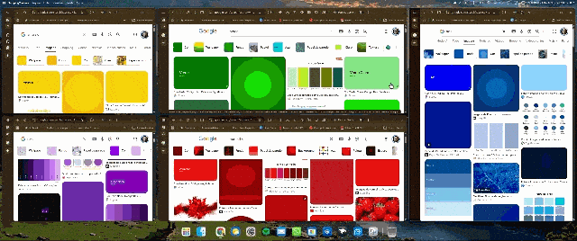
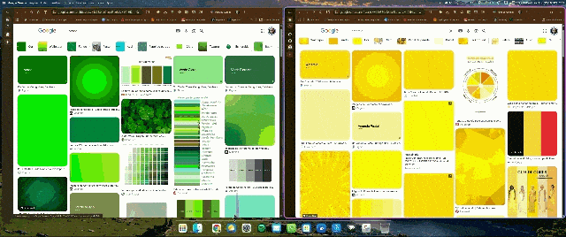
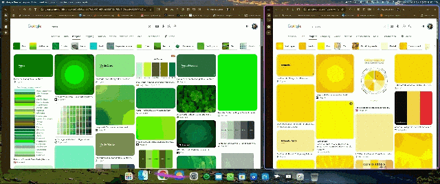

# Adaptive Windows

*(Português do Brasil logo abaixo / Brazilian Portuguese below)*

## English

An automatic tiling window manager for Windows 11, inspired by the **Nava OS** concept videos.
It arranges the windows of each monitor in a grid, animates every change with fluid transitions,
and works together with minimize / restore / open animation mods: a window is animated
**straight to the new place assigned by the grid**, not to where it used to be.

The mod runs in its own `windhawk.exe` process (a Windhawk "tool mod"), not inside Explorer, so a
problem in it cannot take down the taskbar or File Explorer.

### Features
- **Automatic grid.** A new window takes a slot and the others make room for it; when a window
  closes or is minimized, the rest take over the free space.
- **Respects each app's minimum size.** The grid reshapes itself so no window ends up smaller than
  its app allows or overlaps another one (for example Outlook and Spotify together on a short
  screen). If a chosen layout does not fit, the automatic layout is used.
- **Free resizing.** Drag a window edge and the grid adapts to the width or height you chose.
  Dragging a window by its title and dropping it over another one swaps the two; dropping it
  anywhere else sends it back to its slot.
- **Maximized windows** that return to or enter the grid go back to normal mode and take their slot.
- **Animated border on the focused window** (replaces tacky-border): color, effect (solid, pulse,
  rainbow, gradient), line width, glow, corner radius and offset, so it can match your rounded
  corners mod.
- **Multiple monitors.** Each monitor has its own grid, and windows can be dragged between them,
  including monitors with different display scales. It works within the limits each window or app
  imposes: the minimum size is decided by the app (and grows with the monitor's scale), so an app
  whose minimum is wider than the monitor will overflow its right / bottom edge.

### Hotkeys
| Hotkey | Action |
|--------|--------|
| Win + Ctrl + G (default) | Cycle the layout: auto, columns, rows, grid, main left, main top |
| Win + Ctrl + T (default) | Take the focused window out of the grid (it stays where it is and the others use the space); press again to put it back |
| Win + Alt + F | Focus mode: every window on the monitor fills the screen |
| Win + Alt + ← / → | Swap the focused window with the previous / next one |
| Win + Alt + ↓ | Re-arrange everything and put all windows back in the grid |

The Win + Alt hotkeys can use another modifier in the settings (Ctrl+Alt, Ctrl+Alt+Shift or
Alt+Shift) if another program already uses them; restart the mod after changing. Win+Ctrl+G and Win+Ctrl+T
are the defaults and can be changed in the settings (text fields such as "Ctrl+Alt+G" or
"Win+T"; leave empty to turn the hotkey off). Unavailable hotkeys are reported in the Windhawk
log (error 1409 = already in use).

Win + Ctrl + T is also the default Always On Top shortcut of PowerToys: if you use both, change one of them.

### Works with other animation mods
Adaptive Windows works together with these two mods:

- **Windows Animations**.
  

- **MacOS Minimize Animation** (genie effect for minimize, restore and open).

Those mods hide the window and play their own animation. With the *sync with open/close
animations* option on, Adaptive Windows notices this, puts the window in its final slot while it
is hidden, and only animates the other windows making room, at the same time. Each window has a
single animation, so nothing fights.

For the genie to land in the right place, while a window is minimized the mod writes into Windows
the slot it will occupy when it comes back, and keeps that value up to date as the grid changes.
This way the restore animation ends where the window will really be.

Programs you exclude in the other mod (for example Word in the genie mod) are not animated by it;
in that case Adaptive Windows uses its own entrance animation.

### Animations
The **Nava OS** style is the base (strong ease-out curve, new windows slide in from the right).
There are also Smooth (slides in from the top), Snappy (no entrance effect) and Playful (enters from the
bottom with a slight overshoot). While moving, a window keeps a fixed size (like when dragging):
shrinking windows shrink at the start and growing ones only grow at the end, so nothing overlaps.
The frame rate can follow the DWM (recommended) or be fixed.

### Taskbar and dock
The usable area is the Windows work area. The screen-edge margin applies to all four sides. If the
taskbar is hidden, windows only respect the screen edge. The bottom spacing setting (0 = automatic)
is meant for docks drawn by another mod: enter the distance from the screen edge to the top of
the dock. The taskbar can be on any edge of any monitor: the grid follows the Windows work
area, and is re-computed when a monitor is connected or removed, the resolution changes, or the
taskbar is moved or toggles auto-hide.

### Corners
Uses the Windows 11 corner preference (default, rounded, small, square). Windows does not allow an
arbitrary radius this way. If you already use a corner mod (for example "Custom Window Corner
Radius"), leave this option on "do not touch" so the two do not fight over the corners.

### Ignored windows and limits
- Tool windows, always-on-top, non-focusable and non-resizable windows (panels, widgets) stay out
  of the grid, as do the ones in the **windows to ignore** list (part of the title or class,
  separated by semicolons). The list is empty by default.
- Windows that refuse to be positioned (a likely case is programs running as administrator) float
  after a few attempts; Win + Alt + ↓ tries again.

---

## Português (Brasil)

Gerenciador de janelas em grade automática para o Windows 11, inspirado nos vídeos de conceito
do **Nava OS**. Ele organiza as janelas de cada monitor, anima as mudanças com transições fluidas
e funciona junto com os mods de animação de minimizar, restaurar e abrir janelas: a janela
é animada **já para o novo lugar definido pela grade**, e não para onde ela estava antes.

O mod roda em um processo `windhawk.exe` próprio (um "tool mod" do Windhawk), e não dentro do
Explorer, então um problema nele não derruba a barra de tarefas nem o Explorador de Arquivos.

### O que ele faz
- **Grade automática.** Cada janela nova ocupa um espaço da grade e as outras abrem espaço para
  ela; ao fechar ou minimizar uma janela, as demais ocupam o espaço livre.
- **Respeita o tamanho mínimo de cada app.** O formato da grade se ajusta sozinho para que nenhuma
  janela fique menor do que o app aceita nem sobreponha outra (por exemplo, Outlook e Spotify
  juntos numa tela de pouca altura). Se um layout escolhido não couber, ele usa o automático.
- **Redimensionamento livre.** Arraste a borda de uma janela e a grade se adapta à largura ou à
  altura que você escolheu. Arrastar uma janela pelo meio e soltá-la sobre outra troca as duas
  de lugar; soltá-la em qualquer outro ponto a devolve ao seu espaço.
- **Janelas maximizadas** que voltam ou entram na grade passam ao modo normal e assumem o espaço.
- **Borda animada na janela em foco** (substitui o uso do tacky-border): cor, efeito (fixa,
  pulsar, arco-íris, degradê), largura da linha, brilho, raio dos cantos e deslocamento, para
  alinhar com o seu mod de cantos arredondados.
- **Vários monitores.** Cada monitor tem a sua própria grade, e as janelas podem ser arrastadas
  entre eles, inclusive entre monitores de escalas diferentes. Funciona dentro dos limites
  impostos por cada janela ou app: o tamanho mínimo é decidido pelo app (e cresce com a escala do
  monitor), então um app cujo mínimo é maior que a largura do monitor vai passar da borda direita
  / de baixo.

### Atalhos
| Atalho | Ação |
|--------|------|
| Win + Ctrl + G (padrão) | Troca o layout: automático, colunas, linhas, grade, principal à esquerda, principal em cima |
| Win + Ctrl + T (padrão) | Tira a janela em foco da grade (ela fica onde está e as outras ocupam o espaço); apertar de novo devolve à grade |
| Win + Alt + F | Modo foco: todas as janelas do monitor ocupam a tela toda |
| Win + Alt + ← / → | Troca a janela em foco com a anterior / a próxima |
| Win + Alt + ↓ | Reorganiza tudo e devolve todas as janelas à grade |

Os atalhos com Win + Alt podem trocar de modificador nas configurações (Ctrl+Alt, Ctrl+Alt+Shift
ou Alt+Shift) caso outro programa já os use; reinicie o mod depois de mudar. Win+Ctrl+G e Win+Ctrl+T são
os padrões e podem ser trocados nas configurações (campos de texto como "Ctrl+Alt+G" ou "Win+T";
deixe vazio para desligar o atalho). Atalhos indisponíveis aparecem no log do Windhawk
(erro 1409 = já em uso).

Win + Ctrl + T também é o atalho padrão do Always On Top do PowerToys: se você usa os dois, troque um deles.

### Funciona junto com outros mods de animação
O Adaptive Windows funciona junto com estes dois mods:

- **MacOS Minimize Animation** (genie de minimizar, restaurar e abrir).
- **Windows Animations**.

Esses mods escondem a janela e tocam a animação sozinhos. Com *Sincronizar com animações de
abrir/fechar* ligado, o Adaptive Windows percebe isso, posiciona a janela no espaço final enquanto
ela está escondida e anima só as outras janelas abrindo espaço, ao mesmo tempo. Cada janela tem
uma única animação, sem briga.

Para o genie voltar ao lugar certo, enquanto uma janela está minimizada o mod grava no Windows o
espaço que ela vai ocupar quando voltar e mantém esse valor atualizado conforme a grade muda.
Assim a animação de restaurar termina onde a janela de fato vai ficar.

Programas que você excluir do outro mod (por exemplo, o Word no genie) não são animados por ele;
nesse caso o Adaptive Windows usa a própria animação de entrada.

### Animações
O estilo **Nava OS** é a base (curva de saída forte, janela nova entra deslizando da direita).
Há também os estilos Suave (entra deslizando de cima), Rápido (sem efeito de entrada) e Elástico
(entra de baixo com leve ressalto). Durante o movimento a janela mantém o tamanho (como ao
arrastar): as que diminuem encolhem no início e as que crescem só crescem no final, sem
sobreposição. A taxa de quadros pode seguir o DWM (recomendado) ou ser fixada.

### Barra de tarefas e dock
A área útil é a área de trabalho do Windows. A **Margem da borda da tela** vale para os quatro
lados. Se a barra de tarefas estiver escondida, as janelas respeitam apenas a borda da tela.
**Espaço embaixo** (0 = automático) serve para docks desenhados por outro mod: informe a distância
da borda da tela até o topo do dock. A barra de tarefas pode ficar em qualquer lado de qualquer monitor: a grade segue a área
de trabalho do Windows e é refeita quando um monitor é conectado ou removido, a resolução muda, ou a
barra é movida ou muda a opção de ocultar automaticamente.

### Cantos
Usa a preferência de cantos do próprio Windows 11 (padrão, arredondado, pequeno, quadrado).
O Windows não permite raio arbitrário por esta via. Se você já usa um mod de cantos (por exemplo,
"Custom Window Corner Radius"), deixe esta opção em "Não mexer" para os dois não disputarem
os cantos.

### Janelas ignoradas e limites
- Ficam fora da grade janelas de ferramenta, sempre no topo, sem foco, sem moldura redimensionável
  (por exemplo, painéis e widgets), e as da lista **Janelas a ignorar** (parte do título ou da
  classe, separadas por ponto e vírgula). A lista vem vazia por padrão.
- Janelas que não aceitam ser posicionadas (um caso provável são programas executados como
  administrador) passam a flutuar depois de algumas tentativas; Win + Alt + ↓ tenta de novo.
